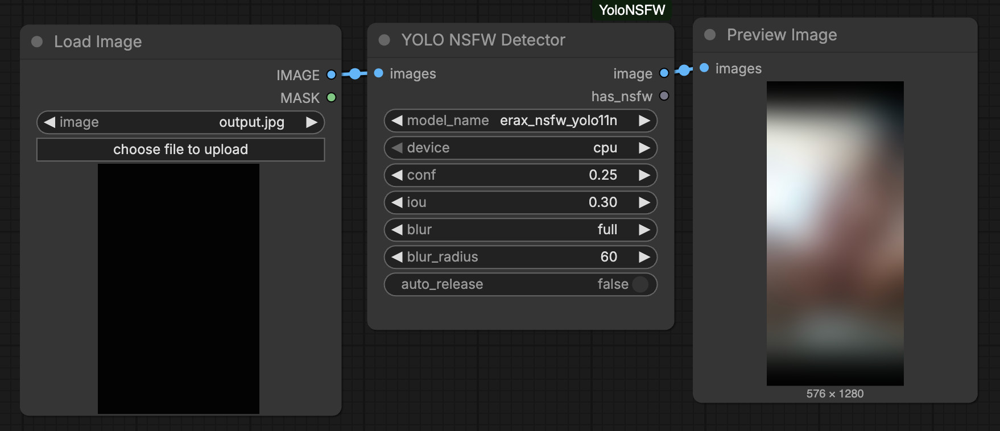

# ComfyUI-YoloNSFW

English | [中文](README_zh.md)

A ComfyUI custom node for NSFW (Not Safe For Work) content detection using YOLO models. Automatically detect and optionally blur adult content in images.

This node uses the Erax AI [erax-ai/EraX-NSFW-V1.0](https://huggingface.co/erax-ai/EraX-NSFW-V1.0) model.

## Installation

### Prerequisites

- Python 3.10+
- ComfyUI installed

### Install the Node

```bash
cd ComfyUI/custom_nodes
git clone https://github.com/er1cw00/ComfyUI-YoloNSFW.git
cd ComfyUI-YoloNSFW
pip install -r requirements.txt
```

Restart ComfyUI

## Model Setup

Models are automatically downloaded on first use and stored in:
```
ComfyUI/models/nsfw/
├── models/
│   └── nsfw/   
│       ├── erax_nsfw_yolo11n.pt  # Lightweight, fastest
│       ├── erax_nsfw_yolo11s.pt  # Balanced
│       └── erax_nsfw_yolo11m.pt  # Best accuracy, slower
```

Source: [erax-ai/EraX-NSFW-V1.0](https://huggingface.co/erax-ai/EraX-NSFW-V1.0)

Or you can manually download from the link above and place them in the directory.

## Usage

### Blur Modes

- **none**: Returns original image without any blur
- **full**: Applies Gaussian blur to the entire image
- **partial**: Applies Gaussian blur only to detected NSFW regions (if any)



## License

MIT License
