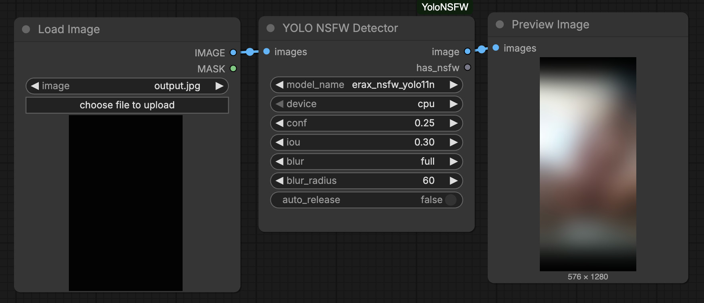

# ComfyUI-YoloNSFW

[English](README_zh.md) | 中文

使用 YOLO 模型进行 NSFW（不适宜工作场所）内容检测的 ComfyUI 自定义节点。自动检测并可选择性地模糊图像中的成人内容。

本节点使用 Erax AI [erax-ai/EraX-NSFW-V1.0](https://huggingface.co/erax-ai/EraX-NSFW-V1.0) 模型。


## 安装

### 前置要求

- Python 3.10+
- 已安装 ComfyUI

### 安装节点

```bash
cd ComfyUI/custom_nodes
git clone https://github.com/er1cw00/ComfyUI-YoloNSFW.git
cd ComfyUI-YoloNSFW
pip install -r requirements.txt
```

重启 ComfyUI


## 模型设置

模型会在首次使用时自动下载并存储在：
```
ComfyUI/models/nsfw/
├── models/
│   └── nsfw/   
│       ├── erax_nsfw_yolo11n.pt  # 轻量级，最快
│       ├── erax_nsfw_yolo11s.pt  # 平衡型
│       └── erax_nsfw_yolo11m.pt  # 精度最高，较慢
```

来源：[erax-ai/EraX-NSFW-V1.0](https://huggingface.co/erax-ai/EraX-NSFW-V1.0)

也可以从上述链接手动下载并放入该目录。

## 使用说明

### 模糊模式

- **none**：返回原图，不做任何模糊处理
- **full**：对整个图像应用高斯模糊
- **partial**：仅对检测到的 NSFW 区域应用高斯模糊



## 许可证

MIT License
